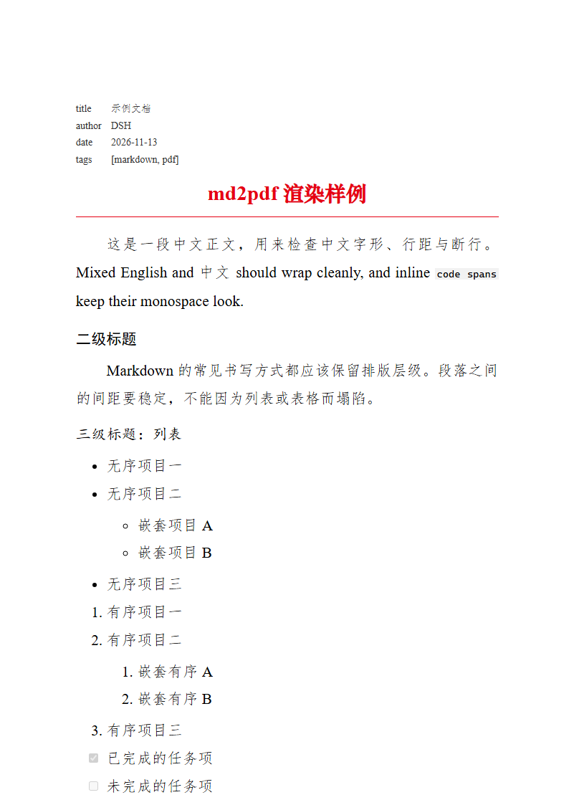
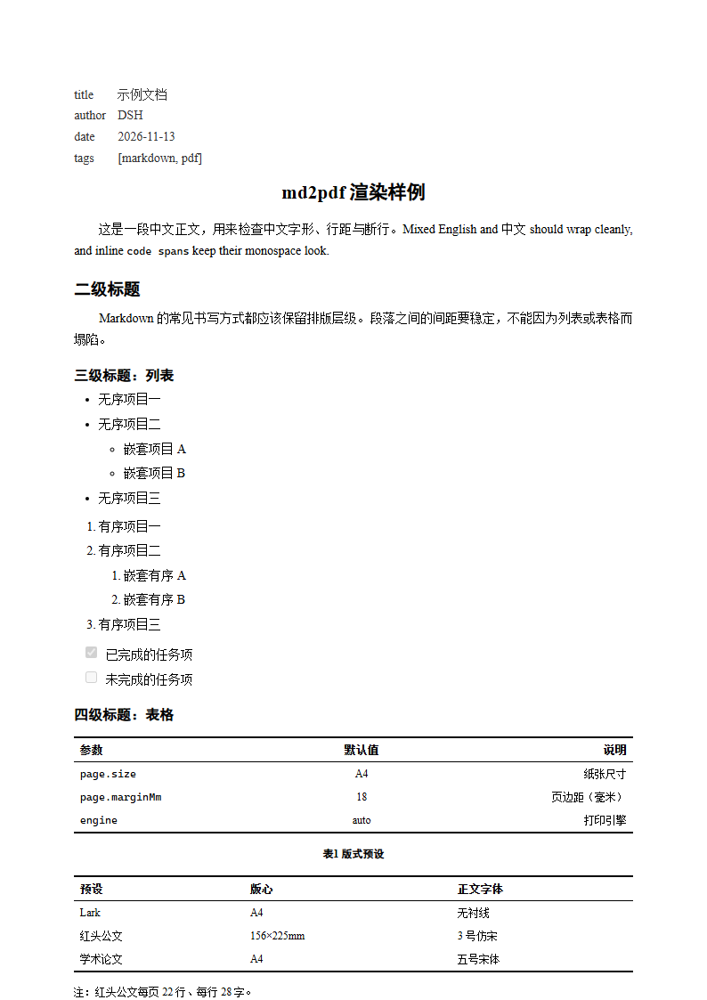
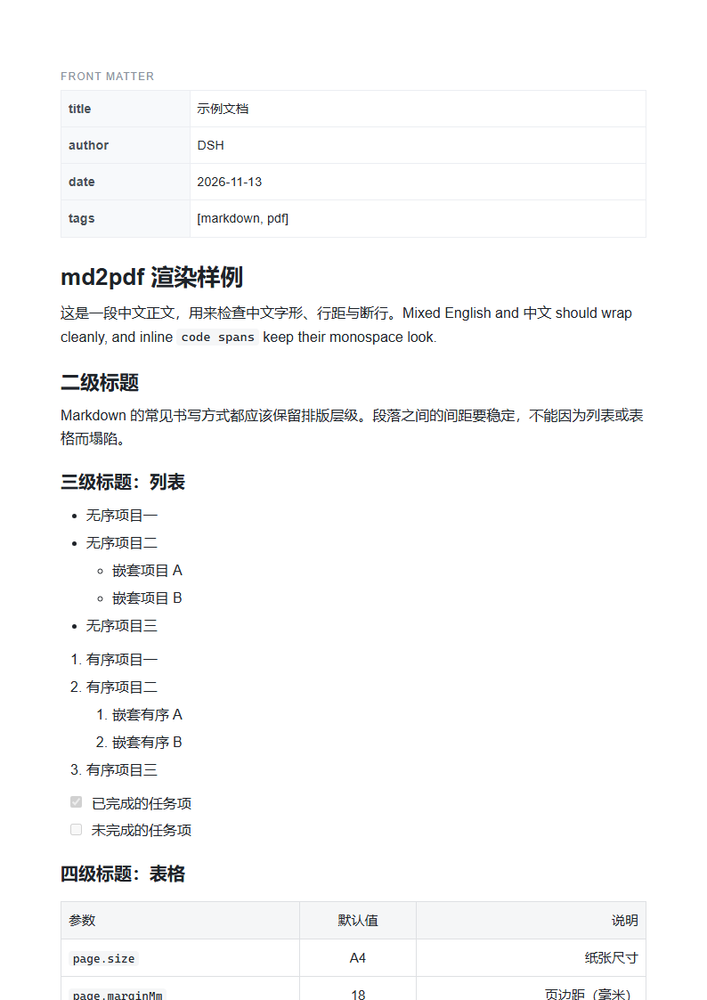
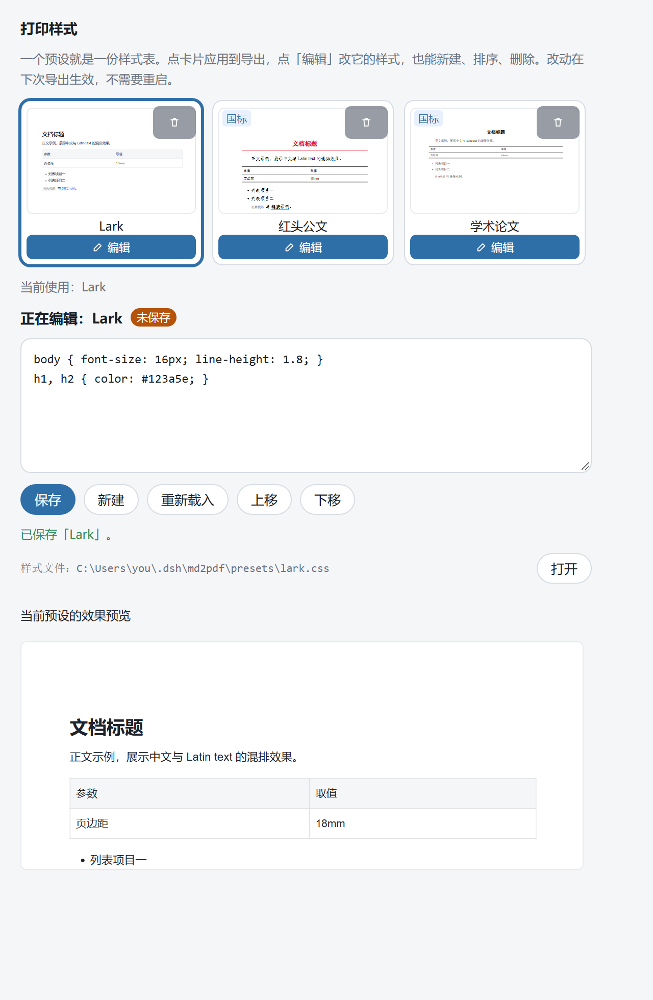

# dsh-md2pdf

English | [中文](README.md)

Export the Markdown open in a DeepSeek Harness sidebar file tab to a PDF beside the source file. The printed page style comes from editable presets.

## What it is

A DSH sidebar plugin. Open a `.md` file in the right-hand file tab, right-click or press one button, and a PDF with the same name appears in the same directory.

- Three entry points: a file-tree row, the file tab toolbar, and the file tab path label.
- No external tools: no pandoc, no LaTeX, no command-line program. Rendering happens inside the plugin.
- Editable presets: each preset is one CSS file. Apply, edit, create, reorder and delete them, and open a preset's stylesheet in your own editor.
- Chinese national-standard layouts: an official document preset built on GB/T 9704-2012 and an academic paper preset built on GB/T 7713.2-2022, both with three-line tables.
- Agent-callable: the `md2pdf_export` tool exports any Markdown path.

## Result

The first page of one sample document, laid out by each built-in preset:

| Official document | Academic paper | Lark |
|---|---|---|
| [](samples/sample-gongwen.pdf) | [](samples/sample-paper.pdf) | [](samples/sample-lark.pdf) |

Click an image to open the full PDF. All three live in `samples/`.

The official document preset uses a 156×225 mm type area, 16 pt FangSong body text on a 29 pt pitch, 22 lines of 28 characters per page. The paper preset uses 25/22 mm margins and 10.5 pt Song body text with a 16 pt Heiti title. Both separate Latin from Chinese: letters and digits take Times New Roman, Chinese characters fall back to FangSong, Heiti or Song.

## Install

Add a dependency in the DSH profile directory. For a source checkout, link it so edits take effect immediately:

```json
{ "dependencies": { "dsh-md2pdf": "link:D:/path/to/dsh-md2pdf" } }
```

```powershell
pnpm install
```

Once the package is on npm, a version range works instead:

```json
{ "dependencies": { "dsh-md2pdf": "^0.1.0" } }
```

Either way, add `dsh-md2pdf` to `dsh.profile.bundles` in the same file and restart DSH.

Requirements: Node.js 20.11 or newer, and one Chromium-based browser (Edge, Chrome, Chromium or Brave). When the Host process can load Electron, the application's own process prints instead.

## Usage

The plugin works on file tabs opened in the right sidebar. Markdown rendered in a chat message is out of scope; open the `.md` file as a tab first.

| Where | Action | Scope |
|---|---|---|
| Sidebar file tree | Right-click → Export to PDF | `.md` and the other Markdown extensions |
| File tab toolbar | Click the PDF icon | The Markdown open in that tab |
| File tab path label | Right-click → Export to PDF | The Markdown open in that tab |
| Settings → dsh-md2pdf | Choose and edit presets | Global |
| `md2pdf_export` tool | Called by an agent | Any Markdown path |

The output path is fixed: `<source dir>/<source stem>.pdf`. An existing PDF is overwritten.

## Interface

The settings page shows three preset cards above the editor and the stylesheet path.



A card carries three hot zones, shown on hover:

- Upper part: use this preset.
- Blue bar underneath: load that preset's CSS into the editor.
- Trash icon in the top-right corner: delete, after confirmation.

A thumbnail is that preset's real rendering, scaled down, so colours, type scale, page margins and table rules match the exported PDF. An unmodified national-standard preset carries a GB badge.

The editor title names the preset being edited and adds an "unsaved" badge once you change something. Saving opens a name dialog prefilled with the current name; a name already used by another preset asks before replacing it, and a new name creates a preset. The toolbar also offers New, Reload, Move up and Move down, plus Restore built-in presets once one has been deleted.

The Open button beside the stylesheet path hands the current preset's CSS to your own editor. Save, then the next export uses it; no restart.

## More

Preset file format, migration rules, style layering, the printing pipeline, routes and the security boundary, and the full list of limitations: [docs/DESIGN.md](docs/DESIGN.md) (Chinese).

## License and credits

MIT, see [LICENSE](LICENSE).

The Lark preset takes its palette, type scale, line height and spacing from the published design parameters of [imageslr/mweb-themes](https://github.com/imageslr/mweb-themes). That repository declares no licence, so this project copied none of its SCSS; the print CSS was written from those parameters.

The official document and academic paper presets follow GB/T 9704-2012 and GB/T 7713.2-2022.
