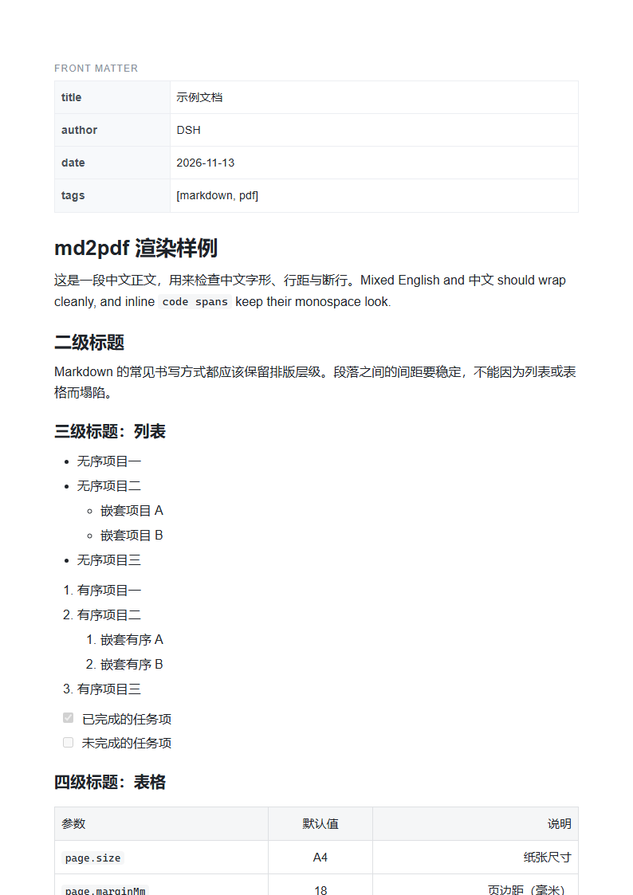

<p align="center">
  
</p>

<h1 align="center">dsh-md2pdf</h1>

<p align="center">
  <a href="https://www.npmjs.com/package/dsh-md2pdf"></a>
  <a href="https://www.npmjs.com/package/dsh-md2pdf"></a>
  <a href="https://github.com/evanliu3594/dsh-md2pdf/blob/main/LICENSE"></a>
  <a href="https://github.com/evanliu3594/dsh-md2pdf/blob/main/package.json"></a>
  <a href="https://www.dsh.so/artifact/dsh-md2pdf-3/?ref=badge"></a>
</p>

<p align="center"><a href="https://github.com/evanliu3594/dsh-md2pdf/blob/main/README.en.md">English</a> | 中文</p>

把 DeepSeek Harness 侧边栏里打开的 Markdown 导出成 PDF，PDF 写在源文件同目录。版式由可编辑的预设管理。

## 这是什么

一个 DSH 侧边栏插件。在右侧文件标签里打开 `.md`，右键或点一个按钮，同目录就多出一份同名 PDF。

- 一处触发：文件树行、文件标签工具栏、文件标签路径栏，三处都能发起导出。
- 零外部工具：不需要 pandoc、LaTeX 或任何命令行程序，渲染在插件内完成。
- 预设可管理：每份预设是一份 CSS 文件，可应用、编辑、新建、排序、删除，也能用系统编辑器直接打开。
- 内置国标版式：红头公文按 GB/T 9704-2012，学术论文按 GB/T 7713.2-2022，两者都用三线表。
- DSH 自带打印：桌面版用 DSH 客户端内部的 Chromium 打印，不启动额外浏览器；Web GUI 自动回退到 Edge、Chrome 等。
- 打印版式：页脚页码居中、页眉页脚文字可配、PDF 大纲书签、可点击目录、论文题名块、显式分页。
- 一次性的文档覆盖：页面、页眉、页脚、页码、目录只在设置页改，作用于本窗口后续导出，源文件不变。
- 供 Agent 调用：注册 `md2pdf_export` 工具，可导出任意 Markdown 路径。

## 效果

同一份样张，三个内置预设各自排出来的第一页：

| 红头公文 | 学术论文 | Lark |
|---|---|---|
| [](https://github.com/evanliu3594/dsh-md2pdf/blob/main/samples/sample-gongwen.pdf) | [](https://github.com/evanliu3594/dsh-md2pdf/blob/main/samples/sample-paper.pdf) | [](https://github.com/evanliu3594/dsh-md2pdf/blob/main/samples/sample-lark.pdf) |

点图可看完整 PDF。三个文件都在 `samples/` 下。

公文版心 156×225 mm，正文 3 号仿宋、29pt 行距，每页 22 行、每行 28 字。论文版心 25/22 mm，五号宋体正文，题名三号黑体居中。两个预设都分开排中英文：拉丁字母与数字用 Times New Roman，汉字回退到仿宋、黑体或宋体。

## 安装

插件已发布到 npm：[dsh-md2pdf](https://www.npmjs.com/package/dsh-md2pdf)，当前版本 0.1.1。

在 DSH profile 的 `package.json` 里写版本范围：

```json
{ "dependencies": { "dsh-md2pdf": "^0.1.1" } }
```

```powershell
pnpm install
```

改源码时改用链接形式，改动即时生效，同样运行 `pnpm install`：

```json
{ "dependencies": { "dsh-md2pdf": "link:/path/to/dsh-md2pdf" } }
```

Windows 路径写成 `link:C:/path/to/dsh-md2pdf`。

两种方式都要把 `dsh-md2pdf` 加进同一文件的 `dsh.profile.bundles`，然后重启 DSH。

前提：Node.js 20.11 或更新版本。

两种运行环境：

- DSH Desktop：用应用自带的 Chromium 打印，PDF 出现在右侧预览里；Windows 与 macOS 都适用。
- Web GUI：没有客户端打印器，自动回退到本机 Chromium 内核浏览器（Edge、Chrome、Chromium、Brave 任一）。回退只保证正文与分页，不支持页眉、页脚、页码与 PDF 大纲。

## 使用

插件作用于右侧边栏打开的文件标签。聊天里渲染的 Markdown 不在范围内，先把 `.md` 文件作为标签打开。

| 位置 | 操作 | 范围 |
|---|---|---|
| 侧边栏文件树 | 右键 → 导出为 PDF | `.md` 等 Markdown 后缀 |
| 文件标签工具栏 | 点 PDF 图标 | 该标签中的 Markdown |
| 文件标签路径栏 | 右键 → 导出为 PDF | 该标签中的 Markdown |
| 设置 → dsh-md2pdf | 选择与编辑预设、页面设置 | 全局 |
| 设置 → dsh-md2pdf | 刷新打印引擎、测试打印 | 全局 |
| 设置 → dsh-md2pdf | 文档覆盖：页面、页眉、页脚、页码、目录 | 本窗口后续导出 |
| 设置 → dsh-md2pdf | 诊断：引擎、字体、最近错误、插件目录 | 全局 |
| `md2pdf_export` 工具 | Agent 调用 | 任意 Markdown 路径 |

输出规则固定：`<源目录>/<源文件名去掉后缀>.pdf`。同名 PDF 覆盖。测试打印写在插件目录 `MD2PDF_HOME/test-print`，不进入工作区。

## 打印与版式

在 front matter 里用扁平的 `pdf.*` 键配置本次导出：

```
---
title: 示例文档
pdf.preset: gongwen
pdf.page.size: A4
pdf.page.marginMm: 20
pdf.header: 内部资料
pdf.footer: 第 {page} 页 / 共 {total} 页
pdf.pageNumbers: true
pdf.toc: true
---
```

- 页码：默认页脚为「第 {page} 页 / 共 {total} 页」，居中，作用于所有页。
- 页眉页脚变量：`{page}`、`{total}`、`{title}`、`{author}`、`{date}`；模板逐段转义。
- 目录：按 h1–h3 生成可点击列表，独占一页，正文从下一页开始；不做目录页码。
- 大纲：PDF 查看器里的书签，默认开启，可用 `pdf.outline: false` 关闭。
- 论文题名块：`pdf.paper.title`、`authors`、`affiliations`、`abstract`、`keywords`、`date` 只在学术论文预设渲染，不设独立封面。
- 显式分页：正文单独一行 `<!-- pagebreak -->`。
- 页边距从最终 `@page` 解析，公文 37/26/35/28 mm 不会被覆盖成默认值。

未在 v2 范围：封面、完整红头模板、水印、目录页码、图表交叉引用、批量导出、合并成书。

## 界面

设置页从上到下是打印引擎、页面与文档覆盖、预设库、编辑器与预览、字体、诊断。

卡片分三块热区，鼠标悬停时出现：

- 上半部分：应用这个预设。
- 下方蓝色横条：把该预设的 CSS 读进下方编辑器。
- 右上角垃圾桶：删除，先确认。

缩略图由该预设真实渲染后缩小，配色、字号、页边距、表格线都和导出的 PDF 一致。红头公文与学术论文预设左上角带「国标」标记。

编辑器标题显示正在编辑的预设名，有改动时标「未保存」。保存时弹出名称对话框，默认填当前预设名；名称与别的预设重名会先问是否覆盖，新名称则新建一个预设。工具栏另有新建、重新载入、上移、下移；删过内置预设后，还会出现「恢复内置预设」。

预设卡片下方有三个按钮：

- 导出预设：下载一个 JSON 文件，含全部预设的样式、页面设置与当前选择。
- 导入预设：读入这个 JSON。新预设直接加入；同名预设先确认是否覆盖样式和页面设置。
- 历史：列出当前预设最近 20 次保存前的样式，可恢复到任一快照。每次保存前自动记录，恢复本身也会先记录当前样式。

导入导出的 JSON 只含样式文本与元数据，不含路径，可跨机器使用。

样式文件路径右侧的「打开」按钮用系统默认程序打开当前预设的 CSS。改完保存，下次导出生效，不需要重启。

顶部显示当前打印引擎，旁边有「刷新」与「测试打印」。测试打印生成一页样张，带页脚页码与两个标题，用来确认打印机与版式。页面区域保存纸张、方向、边距与字号到当前预设。

版式预设标题下方有「在侧边栏 Markdown 预览中应用当前预设样式」复选框，默认关闭。勾选后，预设的字体、颜色、标题层级、表格与代码样式会作用到 Markdown 文件预览；`@page` 页边距不生效，预览保留 DSH 容器的内边距。它只覆盖样式，不生成目录、论文题名块或分页。

「文档覆盖」只作用于本窗口后续导出：页面、页眉、页脚、页码、目录。点「应用到本窗口」生效，点「清除覆盖」恢复文件取值；源文件与预设都不改。

「诊断」显示引擎、字体统计、最近错误与插件目录，可复制 JSON。诊断不含文档正文。

## 更多

预设文件格式、迁移规则、样式分层、打印管线、路由与安全边界、完整限制列表，见 [docs/DESIGN.md](https://github.com/evanliu3594/dsh-md2pdf/blob/main/docs/DESIGN.md)。

## 许可与致谢

MIT 许可，见 [LICENSE](https://github.com/evanliu3594/dsh-md2pdf/blob/main/LICENSE)。

Lark 预设的配色、字号阶梯、行距与间距取自 [imageslr/mweb-themes](https://github.com/imageslr/mweb-themes) 的公开设计参数。该仓库未声明开源许可，本项目没有复制其 SCSS，只按这些参数重写了打印用 CSS。

红头公文与学术论文的版式依 GB/T 9704-2012《党政机关公文格式》与 GB/T 7713.2-2022《学术论文编写规则》编写。
