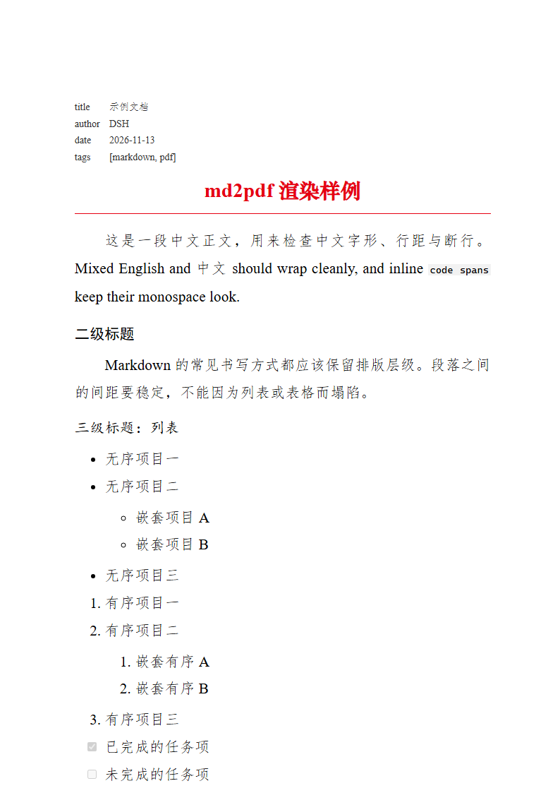
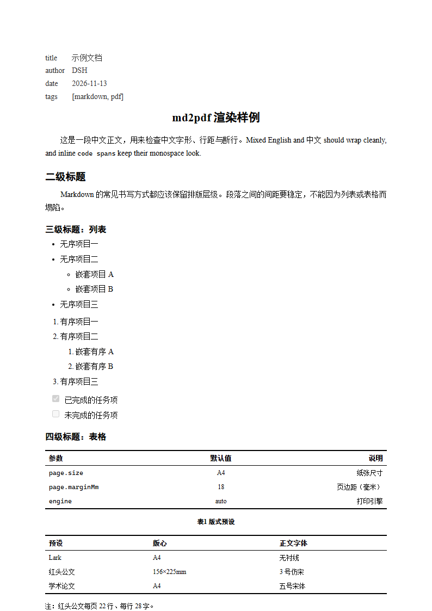
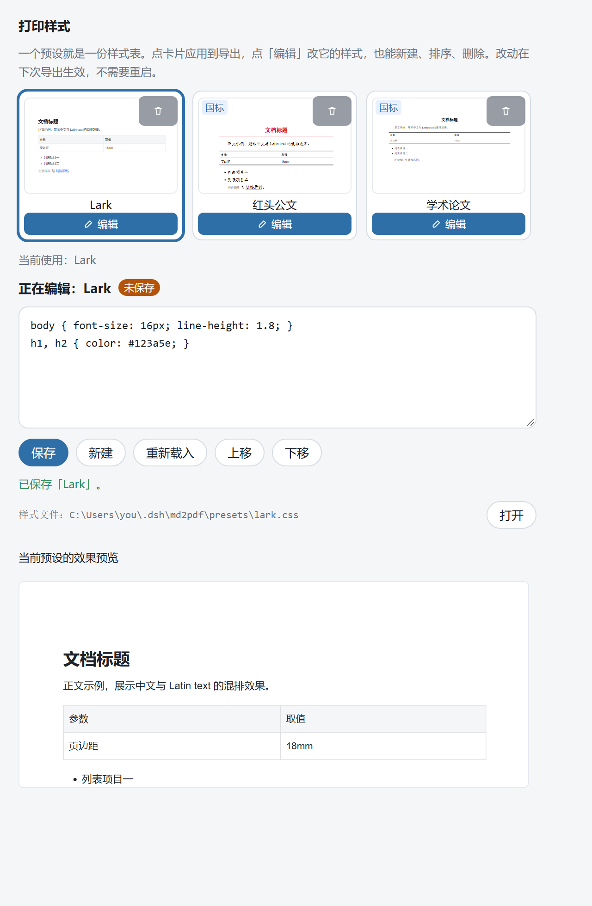

# dsh-md2pdf

[English](README.en.md) | 中文

把 DeepSeek Harness 侧边栏里打开的 Markdown 导出成 PDF，PDF 写在源文件同目录。版式由可编辑的预设管理。

## 这是什么

一个 DSH 侧边栏插件。在右侧文件标签里打开 `.md`，右键或点一个按钮，同目录就多出一份同名 PDF。

- 一处触发：文件树行、文件标签工具栏、文件标签路径栏，三处都能发起导出。
- 零外部工具：不需要 pandoc、LaTeX 或任何命令行程序，渲染在插件内完成。
- 预设可管理：每份预设是一份 CSS 文件，可应用、编辑、新建、排序、删除，也能用系统编辑器直接打开。
- 内置国标版式：红头公文按 GB/T 9704-2012，学术论文按 GB/T 7713.2-2022，两者都用三线表。
- 供 Agent 调用：注册 `md2pdf_export` 工具，可导出任意 Markdown 路径。

## 效果

同一份样张，三个内置预设各自排出来的第一页：

| 红头公文 | 学术论文 | Lark |
|---|---|---|
| [](samples/sample-gongwen.pdf) | [](samples/sample-paper.pdf) | [](samples/sample-lark.pdf) |

点图可看完整 PDF。三个文件都在 `samples/` 下。

公文版心 156×225 mm，正文 3 号仿宋、29pt 行距，每页 22 行、每行 28 字。论文版心 25/22 mm，五号宋体正文，题名三号黑体居中。两个预设都分开排中英文：拉丁字母与数字用 Times New Roman，汉字回退到仿宋、黑体或宋体。

## 安装

在 DSH profile 目录里加一条依赖。从源码安装用链接形式，改动即时生效：

```json
{ "dependencies": { "dsh-md2pdf": "link:D:/path/to/dsh-md2pdf" } }
```

```powershell
pnpm install
```

包发布到 npm 后也可直接写版本号：

```json
{ "dependencies": { "dsh-md2pdf": "^0.1.0" } }
```

两种方式都要再把 `dsh-md2pdf` 加进同一文件的 `dsh.profile.bundles`，然后重启 DSH。

前提：Node.js 20.11 或更新版本，以及一个 Chromium 内核的浏览器（Edge、Chrome、Chromium、Brave 任一）。宿主进程能加载 Electron 时改用应用自身进程打印。

## 使用

插件作用于右侧边栏打开的文件标签。聊天里渲染的 Markdown 不在范围内，先把 `.md` 文件作为标签打开。

| 位置 | 操作 | 范围 |
|---|---|---|
| 侧边栏文件树 | 右键 → 导出为 PDF | `.md` 等 Markdown 后缀 |
| 文件标签工具栏 | 点 PDF 图标 | 该标签中的 Markdown |
| 文件标签路径栏 | 右键 → 导出为 PDF | 该标签中的 Markdown |
| 设置 → dsh-md2pdf | 选择与编辑预设 | 全局 |
| `md2pdf_export` 工具 | Agent 调用 | 任意 Markdown 路径 |

输出规则固定：`<源目录>/<源文件名去掉后缀>.pdf`。同名 PDF 覆盖。

## 界面

设置页顶部是三张预设卡片，下面是编辑器与路径栏。



卡片分三块热区，鼠标悬停时出现：

- 上半部分：应用这个预设。
- 下方蓝色横条：把该预设的 CSS 读进下方编辑器。
- 右上角垃圾桶：删除，先确认。

缩略图由该预设真实渲染后缩小，配色、字号、页边距、表格线都和导出的 PDF 一致。未改动的国标预设左上角带「国标」标记。

编辑器标题显示正在编辑的预设名，有改动时标「未保存」。保存时弹出名称对话框，默认填当前预设名；名称与别的预设重名会先问是否覆盖，新名称则新建一个预设。工具栏另有新建、重新载入、上移、下移；删过内置预设后，还会出现「恢复内置预设」。

样式文件路径右侧的「打开」按钮用系统默认程序打开当前预设的 CSS。改完保存，下次导出生效，不需要重启。

## 更多

预设文件格式、迁移规则、样式分层、打印管线、路由与安全边界、完整限制列表，见 [docs/DESIGN.md](docs/DESIGN.md)。

## 许可与致谢

MIT 许可，见 [LICENSE](LICENSE)。

Lark 预设的配色、字号阶梯、行距与间距取自 [imageslr/mweb-themes](https://github.com/imageslr/mweb-themes) 的公开设计参数。该仓库未声明开源许可，本项目没有复制其 SCSS，只按这些参数重写了打印用 CSS。

红头公文与学术论文的版式依 GB/T 9704-2012《党政机关公文格式》与 GB/T 7713.2-2022《学术论文编写规则》编写。
